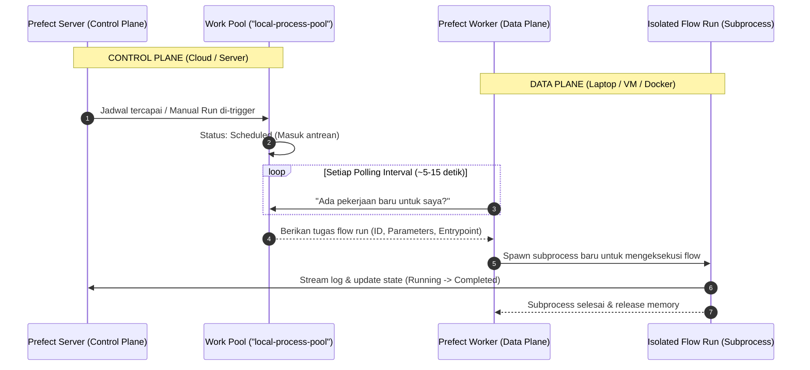

# Sesi 6: Arsitektur Work Pool & Worker

Selamat datang di **Sesi 6**! Di sesi sebelumnya (Sesi 5), kita menggunakan `flow.serve()` di mana satu script Python lokal bertindak sekaligus sebagai pendaftar deployment dan pelaksana eksekusi (*runner*). 

Di dunia nyata dengan skala *Enterprise Data Engineering*, pendekatan tersebut memiliki batasan:
- Bagaimana jika kita memiliki ratusan pipeline yang membutuhkan spesifikasi mesin berbeda (misal pipeline scraping butuh CPU kecil, sedangkan pipeline transformasi machine learning butuh 32GB RAM & GPU)?
- Bagaimana jika kita ingin mengisolasi dependensi agar library antar-pipeline tidak saling bentrok menggunakan container Docker atau Kubernetes?
- Bagaimana jika kita ingin server orkestrator terpusat (*Control Plane*) terpisah sepenuhnya dari server komputasi (*Data Plane*)?

Solusinya adalah **Arsitektur Work Pool & Worker**!

---

## 1. Target Pembelajaran Sesi 6
1. **Control Plane vs Data Plane:** Memahami pemisahan tanggung jawab antara Prefect Server (otak penjadwal) dan Worker (otot eksekutor).
2. **Membuat & Mengonfigurasi Work Pool:** Membuat pool bertipe `process`.
3. **Mendaftarkan Deployment ke Work Pool:** Menggunakan `flow.from_source(...).deploy(...)`.
4. **Menjalankan Prefect Worker:** Memahami cara kerja worker polling dan pemrosesan subproses terisolasi.
5. **Uji Ketahanan (Failure & Late Handling):** Mengetahui perilaku antrean saat worker mati atau belum aktif.

---

## 2. Konsep Inti (80/20 Mental Model)

### Diagram Alur Arsitektur



---

### Perbandingan: `flow.serve()` vs Work Pool & Worker

| Aspek | `flow.serve()` (Sesi 5) | Work Pool & Worker (Sesi 6) |
|---|---|---|
| **Pola Arsitektur** | Monolitik (Runner lokal menyatu dengan script) | Terdistribusi (*Decoupled*: Control Plane vs Execution Plane) |
| **Lingkungan Eksekusi** | Sama persis dengan mesin tempat script dijalankan | Fleksibel: Local Process, Docker Container, Kubernetes Job, AWS ECS |
| **Skalabilitas** | Terbatas pada 1 mesin | Skala dinamis (*Auto-scaling worker* di cloud) |
| **Isolasi Dependensi** | Memakai environment Python lokal yang sama | Bisa terisolasi penuh per flow menggunakan Docker image |
| **Kapan Digunakan?** | *Development*, prototype cepat, atau pipeline personal | *Production*, *Enterprise*, pipeline lintas tim data |

---

### Komparasi Tipe Work Pool

| Tipe Pool | Mekanisme Eksekusi | Kelebihan | Kekurangan | Kapan Dipilih? |
|---|---|---|---|---|
| **Process** | Menjalankan flow sebagai *child process* (`python -m prefect...`) di mesin host | Sangat cepat, minim latency startup, tanpa setup Docker | Berbagi resource dan environment Python dengan host | Server VM dedicated atau tahap pengujian lokal |
| **Docker** | Setiap flow run memicu `docker run` dengan image tertentu | Isolasi total, dependensi package terjamin identik | Memerlukan Docker daemon aktif dan waktu pull image | Multi-tenant team, dependensi C/library unik |
| **Kubernetes** | Setiap flow run membuat Kubernetes Job dinamis | Auto-scaling sejati, resource limit ketat per job | Membutuhkan cluster K8s yang siap pakai | Infrastruktur Big Data / Enterprise Cloud |

---

## 3. Langkah Praktik Terpandu

Pastikan server Prefect Anda tetap menyala di terminal pertama:
```powershell
prefect server start
```
Dashboard UI: [http://127.0.0.1:4200](http://127.0.0.1:4200).

> [!TIP]
> **Tips Windows PowerShell:**
> Prefect CLI menggunakan output visual (*rich glyphs*). Jika Anda menemui error karakter di PowerShell, jalankan perintah ini sekali di terminal Anda:
> ```powershell
> $env:PYTHONIOENCODING="utf-8"
> ```

---

### Langkah 1: Buat & Periksa Work Pool (`01_create_work_pool.py`)

Buka terminal kedua (pastikan virtual environment `.venv` aktif), lalu jalankan:

```powershell
python sesi-06/01_create_work_pool.py
```

Atau menggunakan perintah CLI Prefect langsung:
```powershell
prefect work-pool create "local-process-pool" --type process
```

**Cek di Browser:**
Buka [http://127.0.0.1:4200/work-pools](http://127.0.0.1:4200/work-pools). Anda akan melihat pool bernama `local-process-pool` dengan tipe **process**.

---

### Langkah 2: Daftarkan Deployment ke Work Pool (`02_deploy_to_worker.py`)

Jalankan script pendaftaran:
```powershell
python sesi-06/02_deploy_to_worker.py
```

**Perhatikan Perbedaannya dengan Sesi 5:**
- Di Sesi 5 (`flow.serve`), script tidak pernah selesai dan terminal terkunci sebagai runner.
- Di Sesi 6 (`flow.from_source(...).deploy(...)`), script **langsung selesai dalam 2 detik**! Script ini murni mendaftarkan konfigurasi ke Prefect Server tanpa perlu menjalankan runner sendiri.

**Cek di UI:**
Buka [http://127.0.0.1:4200/deployments](http://127.0.0.1:4200/deployments). Deployment `customer-churn-etl/churn-prediction-worker-pipeline` telah terdaftar dan terhubung ke `local-process-pool`!

---

### Langkah 3: Uji Skenario Ketahanan (Kirim Run SEBELUM Worker Dinyalakan!)

Sekarang kita akan membuktikan salah satu keunggulan arsitektur antrean Prefect. Jalankan script pemicu run:

```powershell
python sesi-06/03_trigger_and_monitor.py
```

**Amati Hasilnya:**
1. Script berhasil mengirim flow run ke Prefect Server.
2. Buka link run yang dicetak di terminal (atau buka tab [Flow Runs](http://127.0.0.1:4200/runs)).
3. Anda akan melihat run berada di state **Scheduled** (atau **Late**).
4. Run tersebut **tidak gagal dan tidak hilang**! Ia tersimpan rapi di dalam antrean Work Pool, menunggu ada Worker yang datang mengambilnya.

---

### Langkah 4: Nyalakan Worker untuk Mengeksekusi Antrean

Sekarang, nyalakan Worker yang bertugas mendengarkan `local-process-pool`:

```powershell
prefect worker start --pool "local-process-pool"
```

**Amati Keajaibannya di Terminal:**
1. Worker akan memulai proses polling:
   ```text
   Starting worker for 'local-process-pool'...
   Worker 'ProcessWorker xxxx' started!
   ```
2. Dalam hitungan detik, Worker mendeteksi flow run yang tadi tertunda di Langkah 3!
3. Worker membuat subprocess baru, menjalankan flow `customer-churn-etl`, mengekstraksi data, menghitung skor churn, dan menyelesaikannya dengan sukses (**Completed**).
4. Cek folder `./data/predictions/` di proyek Anda: file CSV hasil prediksi churn berhasil dibuat!

---

### Langkah 5: Eksplorasi Status Worker di Prefect UI

1. Buka tab **Work Pools** di UI: [http://127.0.0.1:4200/work-pools](http://127.0.0.1:4200/work-pools).
2. Klik nama pool `local-process-pool`:
   - Di tab **Workers**, Anda akan melihat nama worker Anda yang sedang aktif dengan status **Online / Healthy** dan indikator detak jantung (*heartbeat*).
   - Di tab **Work Queues**, Anda dapat mengatur *concurrency limit* (membatasi berapa flow run yang boleh dieksekusi bersamaan).

---

## 4. Review 15 Menit (Lembar Refleksi Sesi 6)

Luangkan waktu 15 menit untuk merefleksikan arsitektur ini:

- [ ] **Alur Lengkap:** Gambar alur: `Deployment Schedule / Trigger` ➔ `Work Pool Queue` ➔ `Worker (Polling)` ➔ `Flow Run Subprocess` ➔ `Result & State Database`.
- [ ] **Kapan memilih Process Pool vs Docker Pool?**
  *(Jawaban: Pilih Process Pool saat ingin setup cepat di server lokal/VM tunggal tanpa overhead container. Pilih Docker Pool saat butuh isolasi dependensi ketat per tim/proyek, atau saat deploy ke cloud ECS/Kubernetes).*
- [ ] **Apa yang terjadi bila Worker mati atau server tempat worker berjalan restart?**
  *(Jawaban: Flow run yang dijadwalkan tidak akan hilang. Prefect Server tetap menyimpan antrean dengan status Scheduled/Late. Begitu worker dinyalakan kembali, worker akan langsung mengambil dan mengeksekusi antrean yang tertunda).*
- [ ] **Pertanyaan Pengantar untuk Sesi 7:**
  *"Bagaimana jika sebuah flow run yang dieksekusi worker tiba-tiba gagal (Failed) atau macet melebihi batas waktu (TimedOut) saat tengah malam ketika tim sedang tidur? Bagaimana kita mendapatkan notifikasi instan ke Slack / Discord / Email tanpa harus memantau layar UI?"*
  *(Jawabannya: Automations & Alerts di Sesi 7!).*
