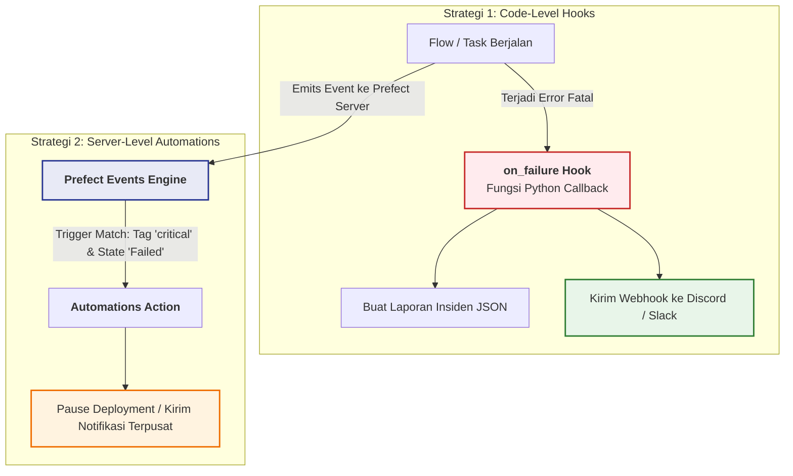

# Sesi 7: Automations & Notifikasi (Observabilitas Produksi)

Selamat datang di **Sesi 7**! Di sesi sebelumnya (Sesi 5 & 6), kita telah mengotomatiskan jadwal dan mengeksekusi pipeline melalui Work Pool & Worker.

Namun di dunia produksi, **kita tidak memantau layar dashboard UI selama 24 jam sehari, 7 hari seminggu**. Ketika sebuah pipeline perbankan atau rekonsiliasi e-commerce gagal di jam 02:00 pagi saat tim data sedang tidur, sistem harus mampu **mengirimkan alert otomatis secara instan** ke saluran komunikasi tim (Slack, Discord, Microsoft Teams, atau Email).

---

## 1. Target Pembelajaran Sesi 7
1. **Prinsip Observabilitas Zero-Noise:** Memahami kapan notifikasi harus dikirim dan bagaimana menghindari *Alert Fatigue*.
2. **State Change Hooks di Kode Python:** Menggunakan `@flow(on_failure=[...])` dan `@task(on_failure=[...])` untuk menangkap insiden dan membuat laporan error.
3. **Webhook Alert Dispatcher:** Memformat payload notifikasi (Discord / Slack Card embed) dengan link langsung ke log investigasi di UI.
4. **Server-Level Automations:** Mengonfigurasi Event Triggers terpusat di dashboard Prefect UI (`/automations`) tanpa menyentuh kode Python.
5. **Simulasi Kegagalan Produksi:** Menguji alur tanggap darurat insiden secara menyeluruh.

---

## 2. Konsep Inti (80/20 Mental Model)

### Dua Strategi Alerting di Prefect



| Fitur | Code-Level Hooks (`on_failure`) | Server-Level Automations (`/automations`) |
|---|---|---|
| **Lokasi Konfigurasi** | Di dalam file kode Python (`@flow`, `@task`) | Di Prefect Server UI atau via API terpusat |
| **Kebutuhan Akses** | Didefinisikan oleh developer pipeline | Dikelola oleh Platform Engineer / Data Lead |
| **Kustomisasi** | Sangat fleksibel (bisa menjalankan sembarang kode Python) | Standar deklaratif (Webhook, Email, Pause Deployment, Trigger Flow) |
| **Kapan Digunakan?** | Alert granular per task, integrasi ke API internal, ekstraksi payload data | Kebijakan tata kelola workspace (misal: "Setiap flow ber-tag `production` yang gagal harus dihentikan jadwalnya") |

---

### Menghindari "Alert Fatigue" (Kelelahan Notifikasi)

Di industri, salah satu kesalahan terbesar tim data junior adalah **mengirim notifikasi untuk setiap flow yang berhasil**. 
- Jika ada 100 pipeline yang berjalan setiap jam, tim akan menerima 2.400 pesan "Success" per hari.
- Akibatnya, tim akan men-mute channel notifikasi tersebut.
- Ketika ada pipeline yang **gagal**, tidak ada yang menyadarinya!

> [!IMPORTANT]
> **Prinsip Emas 80/20 Observabilitas:**
> 1. *Silence is Golden:* Jangan kirim pesan jika semuanya berjalan normal (kecuali laporan rekapitulasi harian/bulanan tingkat tinggi).
> 2. *Actionable Messages:* Setiap alert kegagalan **wajib** mencantumkan:
>    - Nama Flow & Run ID
>    - Ringkasan pesan error (tanpa perlu membuka log untuk tahu inti masalahnya)
>    - Tombol tautan langsung ke URL Prefect UI untuk investigasi lebih cepat
>    - Timestamp dalam UTC / waktu lokal

---

## 3. Langkah Praktik Terpandu

Pastikan server Prefect Anda tetap menyala di terminal pertama:
```powershell
prefect server start
```
Dashboard UI: [http://127.0.0.1:4200](http://127.0.0.1:4200).

---

### Praktik 1: Uji Coba Flow Failure Hook (`01_state_change_hook.py`)

Buka terminal kedua (dengan `.venv` aktif), lalu jalankan:

```powershell
python sesi-07/01_state_change_hook.py
```

**Amati Terminal:**
1. Pipeline settlement perbankan mencoba menghubungi gateway bank, lalu disimulasikan mengalami `ConnectionError (HTTP 503)`.
2. Prefect mendeteksi kegagalan dan secara otomatis menjalankan callback `send_incident_alert`.
3. Terminal mencetak banner peringatan kritis:
   ```text
   🚨 [CRITICAL ALERT DISPATCHED - ON_FAILURE HOOK] 🚨
   Flow Name     : payment-settlement-flow
   State         : Failed
   Ringkasan     : Bank Partner API timeout setelah 30 detik (HTTP 503).
   Investigasi UI: http://127.0.0.1:4200/runs/flow-run/...
   ```
4. Buka folder `./data/alerts/`: sebuah file laporan insiden berformat JSON berhasil dibuat secara otomatis dengan metadata lengkap!

---

### Praktik 2: Task-Level Hook & Universal Webhook Dispatcher (`02_task_and_flow_notifications.py`)

Jalankan script kedua:

```powershell
python sesi-07/02_task_and_flow_notifications.py
```

**Konsep yang Diuji:**
1. **Task Hook (`task_failure_alert`):** Menangkap error pada sensor spesifik (`download-remote-sensor-data`) saat sensor timeout.
2. **Flow Hook (`flow_failure_alert`):** Menangkap penghentian flow secara keseluruhan.
3. **Webhook Card Formatter:** Membuat payload standar yang siap dikirim ke channel Discord / Slack.
4. Payload simulasi tersimpan di `./data/alerts/webhook_mock_<id>.json`.

> [!TIP]
> **Integrasi Otomatis dengan File `.env`:**
> Script sekarang otomatis memuat `DISCORD_WEBHOOK_URL` dari file [.env](file:///c:/Users/Rivaldi/Documents/Papal/Project/Prefect%20tutor/.env) menggunakan `python-dotenv`.
> Cukup pastikan baris ini ada di file `.env` Anda:
> ```env
> DISCORD_WEBHOOK_URL=https://discord.com/api/webhooks/...
> ```
> Saat Anda menjalankan `python sesi-07/02_task_and_flow_notifications.py` atau `python sesi-07/01_state_change_hook.py`, pesan alert kartu interaktif (merah) akan langsung mendarat di channel Discord Anda!

---

### Praktik 3: Server-Level Automations via UI (`03_production_flow_with_automation.py`)

Sekarang kita akan mencoba fitur orkestrasi otomatis tingkat lanjut di Prefect Server.

#### Langkah A: Daftarkan Deployment Produksi Kritis
Jalankan script pendaftaran:
```powershell
python sesi-07/03_production_flow_with_automation.py
```
Deployment `critical-banking-settlement/critical-banking-production` dengan tag `["production", "critical"]` telah terdaftar di Work Pool `local-process-pool`.

#### Langkah B: Konfigurasi Automation di Browser UI
1. Buka browser: [http://127.0.0.1:4200/automations](http://127.0.0.1:4200/automations)
2. Klik tombol **+ Automation** (atau **Create Automation**):
   - **Trigger Type:** Pilih **Flow run state**
   - **Flow Run States:** Centang **Failed** dan **Crashed**
   - **Filter by Tags:** Ketik tag `critical`
   - **Actions:** Pilih **Pause a deployment**, lalu pilih deployment `critical-banking-settlement/critical-banking-production`.
   - **Name:** Beri nama `auto-pause-critical-banking-on-failure`.
3. Klik **Save**.

#### Langkah C: Picu Run dan Saksikan Server Automation Beraksi!
Pastikan worker Anda aktif di terminal terpisah (`prefect worker start --pool "local-process-pool"`).
Lalu picu run deployment:
```powershell
prefect deployment run "critical-banking-settlement/critical-banking-production"
```

**Amati Hasilnya:**
1. Worker mengeksekusi run dan run tersebut gagal sesuai simulasi error database.
2. Prefect Events engine di server langsung menangkap event kegagalan dari flow bertag `critical`.
3. Buka tab [Deployments](http://127.0.0.1:4200/deployments): Anda akan melihat deployment `critical-banking-production` **otomatis berubah status menjadi PAUSED**!
4. Ini adalah mekanisme *circuit breaker* otomatis yang mencegah pipeline gagal terus-menerus mengonsumsi resource atau memperparah kerusakan database!

---

## 4. Review 15 Menit (Lembar Refleksi Sesi 7)

- [ ] **Apakah pesan alert memuat link langsung ke log eksekusi di UI?**
  *(Ya, penyertaan URL `http://127.0.0.1:4200/runs/flow-run/{id}` memangkas waktu Mean Time to Detect/MTTD secara drastis).*
- [ ] **Kapan sebaiknya kita menggunakan `on_failure` di Python vs Automation di UI?**
  *(Gunakan `on_failure` saat butuh logika kustom seperti ekstraksi isi parameter atau format pesan unik. Gunakan UI Automations untuk tata kelola workspace seperti auto-pause deployment atau alert global per tag).*
- [ ] **Bagaimana tim Anda mencegah Alert Fatigue?**
  *(Hanya mengirim alert pada status kegagalan/timeout, memisahkan channel alert berdasarkan severity [P1-Critical vs P3-Warning], dan tidak mengirim pesan untuk run sukses harian).*
- [ ] **Pertanyaan Pengantar untuk Sesi 8:**
  *"Bagaimana orkestrasi Prefect digabungkan dengan Modern Data Stack yang sesungguhnya (Database analitik DuckDB dan transformasi data modelling via dbt)?"*
  *(Jawabannya: Sesi 8: Integrasi Data Stack DuckDB & dbt!).*
