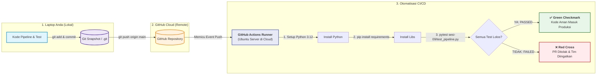

# Panduan Lengkap: Setup Git & Eksekusi CI/CD GitHub Actions

Buku panduan ini dirancang khusus untuk pemula yang ingin memahami dan menguasai alur kerja **Git ➔ GitHub ➔ CI/CD Automation** langkah demi langkah dari nol hingga berhasil melihat centang hijau (*Green Build*) di GitHub!

---

## 1. Peta Konsep: Apa Hubungan Git, GitHub, dan GitHub Actions?



- **Git:** Alat di laptop Anda untuk merekam riwayat perubahan kode (*savegame / commit*).
- **GitHub:** Website / cloud server untuk menyimpan salinan repositori Git Anda secara online.
- **GitHub Actions (CI/CD):** Robot otomatis milik GitHub. Setiap kali Anda melakukan `git push`, robot ini menyalakan server Ubuntu virtual di cloud, mengunduh kode Anda, lalu menjalankan `pytest`. Jika ada test yang gagal, kode ditolak!

---

## 2. Keamanan: File `.gitignore` (Wajib Diperiksa Pertama!)

Sebelum memasukkan file apa pun ke Git, periksa file [.gitignore](file:///c:/Users/Rivaldi/Documents/Papal/Project/Prefect%20tutor/.gitignore). File ini memerintahkan Git agar **tidak pernah mengunggah** file sensitif atau file raksasa ke internet:

- `.venv/` (Folder virtual environment yang beratnya ratusan MB).
- `.env` (File rahasia kredensial database dan Discord webhook token!).
- `*.db` & `*.duckdb` (File database lokal).
- `data/` (Folder dataset).

> [!NOTE]
> Proyek Anda **sudah memiliki file `.gitignore` yang terkonfigurasi dengan benar**, sehingga file rahasia `.env` dan `.venv` Anda 100% aman dan tidak akan ter-push ke GitHub!

---

## 3. Langkah Praktik Terpandu (Zero to Hero)

### Langkah 1: Persiapan & Snapshot Lokal (Commit)

Buka terminal PowerShell Anda di folder proyek `Prefect tutor`.

#### 1. Inisialisasi Git (Jika belum)
```powershell
git init
```
*(Repositori Git sudah diinisialisasi di folder proyek ini).*

#### 2. Pastikan Branch Utama Bernama `main`
```powershell
git branch -M main
```

#### 3. Masukkan Semua File ke Staging Area
Tanda titik (`.`) berarti masukkan semua file dalam proyek kecuali yang ada di `.gitignore`:
```powershell
git add .
```

Anda bisa mengecek statusnya dengan:
```powershell
git status
```
*(Semua file latihan dari Sesi 1 sampai Sesi 9 akan berwarna hijau, artinya siap dicatat).*

#### 4. Buat Rekaman Riwayat (Commit Pertama)
```powershell
git commit -m "feat: masterclass prefect sessions 1 to 9 with pytest and cicd"
```

---

### Langkah 2: Buat Repositori Baru di Website GitHub

1. Buka browser Anda dan login ke [https://github.com](https://github.com).
2. Di pojok kanan atas, klik tanda **+** lalu pilih **New repository** (atau buka [https://github.com/new](https://github.com/new)).
3. Isi informasi repositori:
   - **Repository name:** `prefect-data-orchestration` (atau nama pilihan Anda).
   - **Description:** `Masterclass Portofolio Prefect 3.x, DuckDB, & CI/CD Automation`.
   - **Public / Private:** Pilih **Public** (agar bisa dipamerkan di portfolio/LinkedIn) atau **Private**.
4. **PENTING (JANGAN CENTANG):**
   - ❌ Jangan centang *Add a README file*.
   - ❌ Jangan centang *Add .gitignore*.
   - ❌ Jangan centang *Choose a license*.
   *(Karena kita sudah memiliki file-file ini di komputer kita).*
5. Klik tombol hijau **Create repository**.

---

### Langkah 3: Hubungkan Laptop Anda ke Repositori GitHub

Setelah membuat repo, GitHub akan menampilkan halaman panduan dengan URL repositori Anda, misalnya:
`https://github.com/username-anda/prefect-data-orchestration.git`

Jalankan 2 perintah berikut di PowerShell Anda:

#### 1. Tambahkan Alamat Remote GitHub
Ganti URL di bawah dengan URL repositori Anda yang baru saja dibuat:
```powershell
git remote add origin https://github.com/username-anda/prefect-data-orchestration.git
```

#### 2. Unggah Kode ke GitHub (`git push`)
```powershell
git push -u origin main
```

> [!TIP]
> **Jika Muncul Jendela Login:**
> Windows Git Credential Manager akan membuka browser meminta otorisasi akun GitHub Anda. Cukup klik **Authorize GitCredentialManager** untuk masuk.

---

### Langkah 4: Saksikan Robot GitHub Actions Menjalankan CI/CD!

Begitu proses `git push` selesai:

1. Buka halaman repositori GitHub Anda di browser:
   `https://github.com/username-anda/prefect-data-orchestration`
2. Klik tab **Actions** di menu atas (berada di samping menu *Code*, *Issues*, *Pull requests*).
3. Anda akan melihat workflow bernama **"Prefect Data Engineering CI Pipeline"** sedang berjalan dengan ikon lingkaran kuning berputar 🟡.
4. Klik pada nama commit tersebut untuk melihat proses live:
   - Klik job **Run Unit Tests & Validate Deployments**.
   - Buka dropdown **Run Pytest Test Suite**:
     Anda akan melihat robot Linux menjalankan:
     ```text
     sesi-09/test_pipeline.py::test_normalize_transaction_valid PASSED
     sesi-09/test_pipeline.py::test_calculate_tax_and_discount_tiers PASSED
     sesi-09/test_pipeline.py::test_idempotent_partition_storage PASSED
     sesi-09/test_pipeline.py::test_financial_tax_pipeline_end_to_end PASSED
     ============================== 8 passed in 4.12s ==============================
     ```
5. Dalam ~30 detik, ikon akan berubah menjadi **Centang Hijau (Green Checkmark) ✅**!
6. Selamat! Anda telah berhasil mengimplementasikan *Continuous Integration* tingkat produksi!

---

### Langkah 5: Eksperimen "Sengaja Merusak Kode" (Menguji Perlindungan CI)

Untuk memahami nilai sejati dari CI/CD:
1. Buka file [sesi-09/pipeline_code.py](file:///c:/Users/Rivaldi/Documents/Papal/Project/Prefect%20tutor/sesi-09/pipeline_code.py).
2. Di fungsi `calculate_tax_and_discount`, ubah tarif pajak dari `0.11` menjadi `0.50` (50%).
3. Jalankan commit dan push:
   ```powershell
   git add sesi-09/pipeline_code.py
   git commit -m "test: simulate intentional calculation bug"
   git push
   ```
4. Buka tab **Actions** di GitHub:
   - Robot CI akan mendeteksi perbedaan ekspektasi pada `test_calculate_tax_and_discount_tiers`.
   - Workflow akan otomatis **GAGAL dengan tanda SILANG MERAH ❌**.
   - Ini membuktikan bahwa sistem CI Anda berhasil mencegah kode cacat masuk ke sistem produksi!
5. Kembalikan nilainya ke `0.11`, lalu commit & push lagi untuk mengembalikan centang hijau ✅.

---

## 4. Rangkuman Perintah Singkat Git Sehari-hari

| Perintah | Fungsi |
|---|---|
| `git status` | Melihat file apa saja yang diubah / belum dicatat. |
| `git add .` | Menyiapkan seluruh perubahan ke staging. |
| `git commit -m "pesan"` | Menyimpan rekaman versi dengan catatan jelas. |
| `git push` | Mengirim commit dari laptop ke GitHub (otomatis memicu CI Actions). |
| `git pull` | Mengambil perubahan terbaru dari GitHub ke laptop. |
